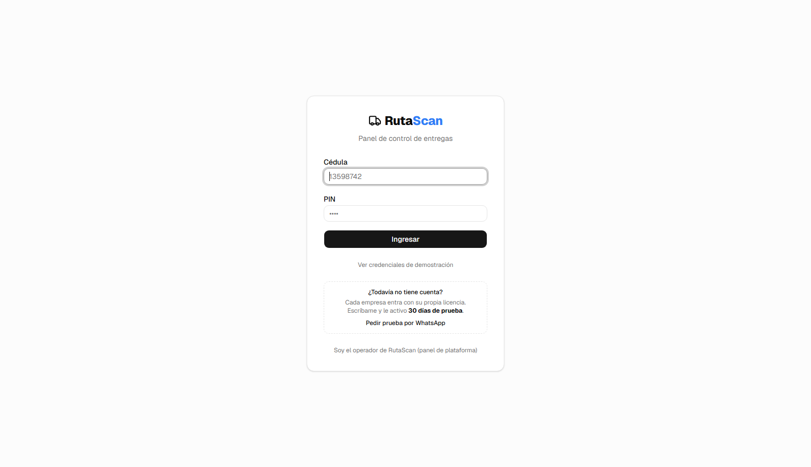
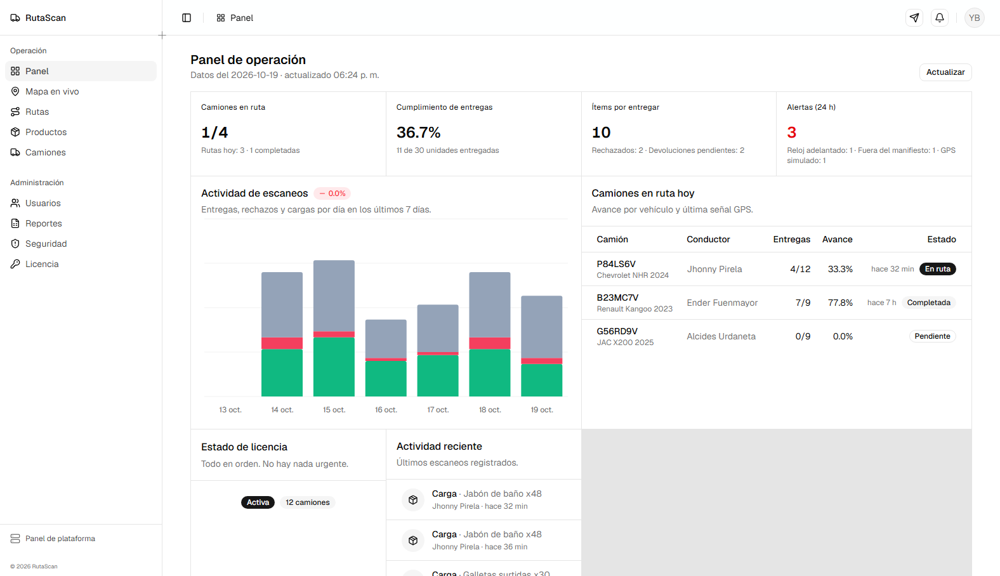
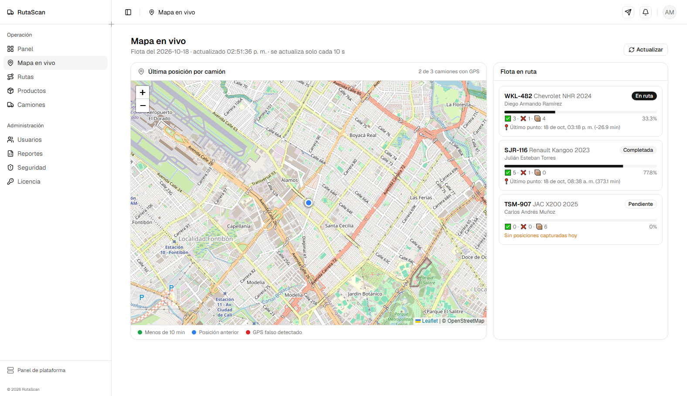
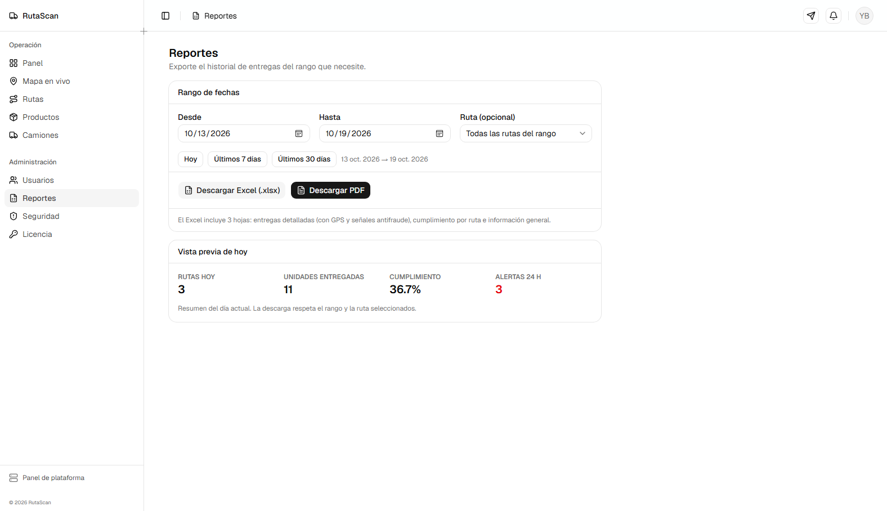
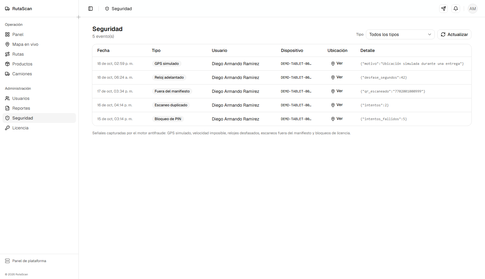

# RutaScan

[](https://github.com/Manolodios/rutascan/actions/workflows/ci.yml)
[](LICENSE)
[](https://rutascan.onrender.com/app/)

SaaS B2B de rastreo de carga con **licenciamiento anti-piratería** y operación
**offline-first**: dashboard web para administración, backend FastAPI y app
Flutter para conductores/bodega.

| Módulo | Tecnología | Carpeta |
| ------ | ---------- | ------- |
| API + licencias | Python 3.11+ · FastAPI · SQLAlchemy 2 · Pydantic v2 · PostgreSQL | `backend/` |
| Panel web | React 19 + Vite + Tailwind v4 + shadcn/ui | `dashboard/` |
| Programa Windows | Electron (ventana propia, arranca el backend) | `desktop/` |
| App móvil | Flutter (Android) — QR, GPS, cola offline, firma/foto | `mobile/` |
| Orquestación | Docker Compose (Postgres 16 + Redis 7 + API) | raíz |

> `web/` **sí se versiona**: es el build del panel (`npm run build:web` dentro de
> `dashboard/`), lo sirve el backend en `/app/` y lo sirve Render en la nube
> sin necesitar Node.js. La página comercial vive en `landing/` y se sirve en `/`.

## 🌐 En línea (demostración para empresas)

RutaScan ya está publicado y funcionando 24/7, **sin depender de ningún PC**
(plan gratuito):

| Qué | Enlace |
| --- | --- |
| Sitio web (promoción) | <https://rutascan.onrender.com> |
| Panel web (PC / tablet) | <https://rutascan.onrender.com/app/> |
| App del celular (APK, 23 MB) | <https://rutascan.onrender.com/uploads/RutaScan-Celular.apk> |
| App para teléfonos antiguos (32 bits, 19 MB) | <https://rutascan.onrender.com/uploads/RutaScan-Celular-32bits.apk> |

El APK ya viene **apuntando a la nube** (se compila con `--dart-define`) y pide
**Android 7 o superior**; no hay que configurar nada en el teléfono. También
está publicado en **[GitHub Releases](https://github.com/Manolodios/rutascan/releases)**.

- **Entrada de demo:** botón *"Ver credenciales de demostración"* en el login, o
  la tabla de credenciales de más abajo.
- **Servidor:** Render (`rutascan`, plan free, región Virginia). Duerme tras
  15 minutos sin visitas y despierta en ~30-60 s; ábralo un minuto antes de una
  demostración.
- **Base de datos:** Supabase (`hkdustypbnkycrcctctg`) con el usuario dedicado
  `rutascan_app` y la API pública cerrada.
- **Actualizar:** cada `git push` a `main` reconstruye el sitio solo (~2 min).
  Guía completa y detalles: `docs/DESPLIEGUE-NUBE.md`.
- **La demo nunca se ve vacía:** la instancia tiene `DEMO_AUTO_REFRESH=true`, así
  que al arrancar corre las fechas del tenant demo hasta hoy (rutas de hoy,
  escaneos recientes, licencia vigente). Solo toca la empresa de demostración,
  nunca a un cliente real. A mano:
  `cd backend && python -m scripts.refrescar_demo`.

## 📸 Capturas

**Inicio de sesión** — con acceso rápido a las credenciales de demostración



**Panel de operación** — rutas del día, cumplimiento de entregas y actividad de escaneos



**Mapa en vivo** — última posición de cada camión (Leaflet + OpenStreetMap)



**Reportes** — Excel y PDF generados por el servidor



**Seguridad** — GPS simulado, reloj adelantado y QR fuera de manifiesto



> Se regeneran solas contra la instancia publicada con
> `powershell -File tools/capturas.ps1` (usa Microsoft Edge en modo oculto).

## Uso diario en Windows

El programa **RutaScan** se instala en el PC y abre en su propia ventana el panel
(<http://127.0.0.1:8000/app/>), arrancando el backend solo y apagándolo al cerrar
la ventana.

| Acceso directo | Qué hace |
| --- | --- |
| **RutaScan** (Escritorio / Inicio) | abre la app de escritorio (ventana propia, ícono de camión) |
| `INSTALAR RutaScan.bat` | (re)crea el acceso directo, el ícono y la entrada de desinstalación |
| `ABRIR RutaScan.bat` | igual que el acceso directo (sin instalación) |
| `PREPARAR CELULAR.bat` | abre el puerto 8000 en el firewall y muestra la IP del PC (una vez) |
| `PUBLICAR RutaScan en Internet.bat` | enlace público HTTPS (Cloudflare Tunnel) para usar la app desde cualquier red |
| `CERRAR RutaScan.bat` | cierra backend, túnel y ventanas |
| `DESINSTALAR RutaScan.bat` | quita la app de Windows (el proyecto y los datos quedan intactos) |

Los lanzadores compilan el panel la primera vez si `web\` todavía no existe:

```bash
cd dashboard && npm install && npm run build:web
```

Para volver a empaquetar e instalar la app de Windows, ver `desktop/README.md`.

### Publicar en internet (gratis, sin tocar el router)

`PUBLICAR RutaScan en Internet.bat` levanta el servidor si hace falta y abre un
túnel de Cloudflare (`cloudflared`, se descarga solo la primera vez) que entrega
un enlace HTTPS público del tipo `https://xxx-yyy-zzz.trycloudflare.com`:

- El panel queda accesible desde cualquier red: `https://…/app/`
- El celular usa esa misma dirección en la app (login → **Servidor**), así que
  ya no depende de la WiFi de la casa.
- El APK instalable también se sirve desde el enlace:
  `https://…/uploads/RutaScan-Celular.apk` (se copia desde el Escritorio).
- El enlace queda en el Escritorio (`URL PUBLICA RutaScan.txt`) y en el
  portapapeles. **Cambia** si se reinicia el PC o se ejecuta
  `CERRAR RutaScan.bat`: vuelva a abrir el `.bat` y use el enlace nuevo.
- Mientras el túnel esté activo, quien tenga el enlace puede entrar; por eso las
  credenciales demo viven detrás de un botón plegable en el login
  (`dashboard/src/components/login-form.tsx`).
- El backend sigue corriendo en este PC (SQLite local): el túnel solo lo expone.

Archivos: `PUBLICAR RutaScan en Internet.bat` y `tools/publicar_internet.ps1`.
El binario `cloudflared.exe` vive fuera del repositorio, en
`%LOCALAPPDATA%\RutaScan\tools\`.

Para un enlace **fijo** que no dependa de este PC ya está montado (gratis, con
Supabase + Render): **<https://rutascan.onrender.com>** (sitio) y
**<https://rutascan.onrender.com/app/>** (panel) ✅. El túnel de Cloudflare
sigue sirviendo como respaldo (y para operar con la base SQLite local); el
servidor de la nube usa la base de datos de Supabase.
`docs/DESPLIEGUE-NUBE.md` explica cómo se montó y cómo actualizarlo.

## Arranque rápido (Docker)

```bash
cp .env.example .env      # edite SECRET_KEY y claves
docker compose up --build
```

- Sitio web: http://localhost:8000/
- Panel web (React): http://localhost:8000/app/
- API (OpenAPI/Swagger): http://localhost:8000/docs
- Healthcheck: http://localhost:8000/health

El backend crea el esquema y siembra datos demo automáticamente al arrancar
(`SEED_DEMO_DATA=true`).

### Credenciales de demo

| Rol | Cédula | PIN | Uso |
| --- | ------ | --- | --- |
| ADMIN | `13598742` | 1234 | Dashboard web |
| WAREHOUSE | `15874230` | 2345 | Dashboard / app |
| DRIVER | `20148379` | 3456 | App móvil |
| DRIVER | `18376452` | 4567 | App móvil |
| DRIVER | `14209876` | 5678 | App móvil |

- Licencia: `RUTA-4F7Q-2MX9-BN38` · Camiones: `P84LS6V`, `B23MC7V`, `G56RD9V`, `A91FB4V`
- Productos demo: 12 referencias con código de barras `7592001000xxx`
- Clave de plataforma (operador SaaS): `PLATFORM_API_KEY` del `.env`

### ¿Vas a mostrárselo a una empresa?

Guion de demostración de 5 minutos, con el orden de las pantallas, qué decir en
cada una y las respuestas a las preguntas difíciles (precio, seguridad, ¿y sin
internet?): **`docs/GUION-DEMO.md`** y la versión imprimible
**`docs/GUION-DEMO-RutaScan.pdf`** (se regenera con
`python tools/guion_demo_pdf.py`).

Para seguimiento por WhatsApp o correo hay una **ficha comercial de una página**:
**`docs/FICHA-COMERCIAL-RutaScan.pdf`** (se regenera con
`python tools/ficha_comercial_pdf.py`). Antes de enviarla, pon tu número de
WhatsApp en el generador.

## Desarrollo local (sin Docker)

Backend (Python 3.11+; se probó también en 3.12–3.14):

```bash
python -m venv .venv
# Windows:  .venv\Scripts\activate      Linux/macOS:  source .venv/bin/activate
pip install -r backend/requirements.txt

cd backend
# apunte DATABASE_URL a un Postgres o use el compose solo para db/redis:
#   docker compose up -d db redis
uvicorn app.main:app --reload --port 8000
```

> Sin PostgreSQL, `database` en `/health` seguirá `down`; los tests y el smoke
> test no lo necesitan (usan SQLite en memoria).

Pruebas:

```bash
# desde backend/
python -m pytest -q                      # 15 pruebas unitarias/integración
PYTHONPATH=. python -m scripts.smoke_test  # E2E con TestClient (SQLite)
```

App móvil: ver `mobile/README.md`. En este PC ya quedó instalado el toolchain
completo (Flutter 3.47.7, JDK 17, Android SDK 36). Para el teléfono en la misma
WiFi:

```powershell
cd mobile
flutter build apk --release --dart-define=API_BASE_URL=http://<IP-del-PC>:8000
```

Ejecute antes `PREPARAR CELULAR.bat` (abre el puerto 8000 en el firewall y le
muestra la IP). El APK queda en
`mobile/build/app/outputs/flutter-apk/app-release.apk`.

> En la app, la dirección del servidor se puede cambiar sin recompilar:
> pantalla de inicio de sesión → `Servidor: …`, o **Ajustes → Cambiar
> dirección**.

## Qué incluye

### Licenciamiento y anti-piratería

- `/api/v1/mobile/*` guardado por `LicenseGuardMiddleware`:
  400 sin cabeceras · 402 licencia inválida/vencida/suspendida ·
  403 `DEVICE_LIMIT_REACHED` si un UUID nuevo excede `max_trucks`.
- Vinculación de dispositivo (cada instalación tiene su UUID) + TTL de
  dispositivo (`DEVICE_TTL_DAYS`).
- **Grace token** firmado de 3 días para operar sin conexión.
- Login cédula + PIN de 4 dígitos (bcrypt) con rate limit y bloqueo temporal.
- Multi-tenant estricto: toda consulta filtra por `company_id` del token.

### Anti-fraude en escaneos

- GPS simulado → bloqueo (422 `MOCK_LOCATION_DETECTED`) + evento de seguridad.
- Heurísticas: velocidad imposible, reloj adelantado, escaneo offline antiguo.
- `scan_uuid` como clave de idempotencia (reintentos jamás duplican).

### Offline-first

- Cola local SQLite en el móvil (`pending_scans`, `pod_pending`) y flush
  atómico con `POST /api/v1/mobile/deliveries/sync-batch` (SAVEPOINT por ítem,
  resultado por ítem).
- Manifiesto cacheado; la app funciona sin señal dentro del periodo de gracia.
- Evidencias de entrega (firma PNG / foto) subidas y adjuntadas
  automáticamente al recuperar la conexión.

### Dashboard (roles ADMIN / WAREHOUSE)

- Panel React único sobre la API: KPIs, mapa en vivo (Leaflet/OpenStreetMap),
  camiones en ruta, rutas (planificar, manifiesto, importar, despachar),
  productos (+ importación y hoja PDF de QR), camiones, usuarios, reportes
  Excel/PDF, licencia/dispositivos y eventos de seguridad.
- Usuarios y licencia solo se muestran al rol ADMIN; el menú se filtra por rol.

### Panel de plataforma (operador SaaS)

- Sección aparte (`#/plataforma`) protegida con `X-Platform-Key`
  (`PLATFORM_API_KEY`), no con el login de empresa.
- Totales de cuentas (operativas, por vencer, vencidas, suspendidas), días de
  licencia restantes por empresa, dispositivos/camiones/usuarios de cada una,
  y alta/renovación/suspensión de cuentas.

## Estructura del repo

```
backend/
  app/
    api/v1/        # auth, mobile/*, admin/*, platform
    services/      # scans, licensing, manifest, reports, qrpdf, imports…
    models/        # SQLAlchemy (companies, users, trucks, products,
                   # routes, route_details, delivery_logs, sync_batches,
                   # devices, security_events)
    middleware/    # LicenseGuardMiddleware
    core/          # config, JWT/bcrypt, cache, geo
    db/            # session + init_db (auto-create + seed demo)
  tests/           # pytest
  scripts/         # smoke_test.py (E2E)
web/               # build del panel (versionado); el backend lo sirve en /app
landing/           # página comercial estática que el backend sirve en /
dashboard/         # panel web (React + Vite + shadcn/ui) + scripts/copy-to-web.mjs
desktop/           # app de escritorio (Electron) + empaquetado
mobile/            # app Flutter
tools/             # instaladores de Windows, capturas del panel, publicación
docs/              # API.md + ARCHITECTURE.md + DESPLIEGUE-NUBE.md + GUION-DEMO + FICHA-COMERCIAL + capturas/
.github/workflows/ # CI: pruebas del backend + compilación del panel
docker-compose.yml
```

## Despliegue

> El despliegue en la nube **ya está hecho y verificado**:
> <https://rutascan.onrender.com> (sitio) y
> <https://rutascan.onrender.com/app/> (panel) con Supabase + Render, plan
> gratuito. Guía completa: `docs/DESPLIEGUE-NUBE.md`. Los pasos siguientes son
> la referencia para levantar otro entorno/servidor.

1. `SECRET_KEY` fuerte (`openssl rand -hex 32`), `PLATFORM_API_KEY`, claves de
   Postgres y `ENVIRONMENT=production` en el entorno.
2. `DATABASE_URL` compatible con Supabase/Neon (agregue `?sslmode=require`).
3. `CORS_ORIGINS` restringido a su dominio del dashboard.
4. Compile el APK móvil con `--dart-define=API_BASE_URL=https://api.sudominio.com`.

## Licencia

RutaScan se publica bajo **AGPL-3.0** (archivo `LICENSE`): puede usarlo,
estudiarlo y mejorarlo libremente, incluso dentro de una empresa. Si ofrece una
versión modificada como servicio en red, debe publicar el código fuente de sus
cambios.

- Cómo contribuir: `CONTRIBUTING.md`
- Reportar fallos de seguridad: `SECURITY.md`

---

Documentación: `docs/API.md` (endpoints y códigos de error) y
`docs/ARCHITECTURE.md` (diseño interno, modelo de datos, seguridad).

