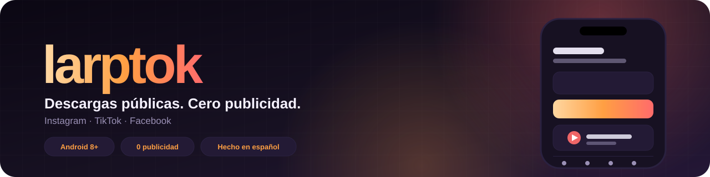
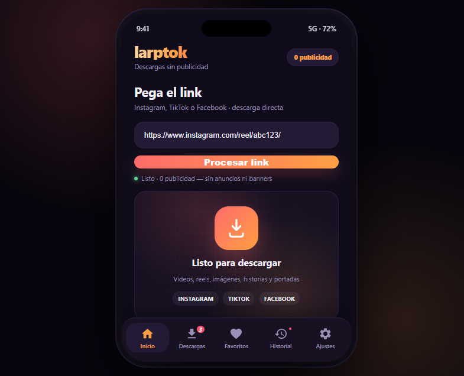
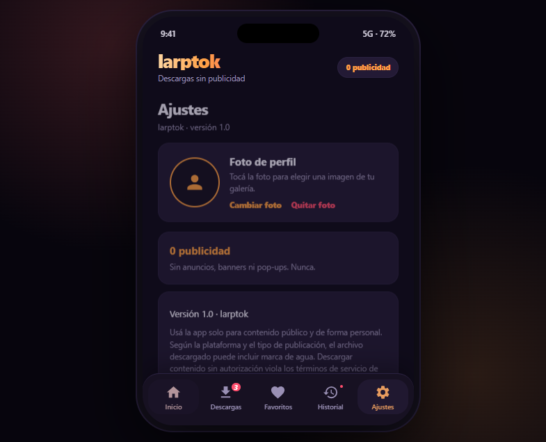

<p align="center">
  
</p>

<p align="center">
  <a href="https://github.com/Manolodios/rutascan/releases/tag/larptok-v1"></a>
  
  
  
  
  
</p>

<h3 align="center">
  Bajá videos, reels e imágenes públicas de Instagram, TikTok y Facebook.<br />
  Sin anuncios, sin cuentas y sin vueltas.
</h3>

<p align="center">
  <a href="#descargar"><b>Descargar APK</b></a> ·
  <a href="#características">Características</a> ·
  <a href="#cómo-compilar">Compilar</a> ·
  <a href="#limitaciones">Limitaciones</a>
</p>

---

## Vista previa

<p align="center">
  
  &nbsp;
  
</p>

<p align="center">
  <sub><b>Inicio</b> · pegá el link y descargá</sub>
  &nbsp;&nbsp;&nbsp;&nbsp;&nbsp;&nbsp;&nbsp;&nbsp;&nbsp;&nbsp;&nbsp;&nbsp;&nbsp;&nbsp;&nbsp;&nbsp;
  <sub><b>Ajustes</b> · foto de perfil y privacidad</sub>
</p>

---

## Descargar

<p align="center">
  <a href="https://github.com/Manolodios/rutascan/releases/download/larptok-v1/larptok-debug.apk">
    
  </a>
</p>

| | |
|:--|:--|
| **Versión** | `1.0` · release `larptok-v1` |
| **Tamaño** | 3.18 MB |
| **Android** | 8.0 o superior (API 26+) |
| **Tipo** | APK de depuración, distribuido directamente (no está en Google Play) |

### Instalación en el teléfono

1. Abrí el link de descarga desde el teléfono e iniciá sesión en GitHub si te lo pide.
2. Descargá `larptok-debug.apk`.
3. Habilitá **Instalar apps desconocidas** para el navegador o la app de archivos.
4. Abrí el APK y confirmá la instalación.
5. Entrá a larptok, pegá el link de una publicación pública y tocá **Procesar link**.

> Para distribuir una versión final, generá el APK de release y firmalo con tu propio keystore. El release publicado acá es de depuración.

---

## Características

| | |
|:--|:--|
| 🎬 **Videos y reels** | Links de Instagram, TikTok y Facebook |
| 🖼️ **Imágenes e historias** | Posts, historias y portadas de reels |
| 🚫 **0 publicidad** | Sin anuncios, banners ni pop-ups. Nunca. |
| 🖤 **Interfaz Mobile 1** | Cinco pestañas con badges, tema oscuro y acentos cálidos |
| 👤 **Foto de perfil** | Elegí una imagen de la galería; se guarda solo en tu teléfono |
| 📥 **Descargas nativas** | `DownloadManager`, con archivos en la carpeta **Descargas** |
| 🔐 **Sin servidores propios** | El contenido se descarga directo desde la página pública |
| 💬 **Hecho en español** | Interfaz completa, sin texto en inglés |

### Cómo funciona

```text
Link público  →  WebView  →  DownloadManager  →  Descargas/
```

larptok abre la publicación original en un WebView y descarga el archivo multimedia que la página expone. No hay un backend que procese ni almacene el contenido.

---

## Uso

1. **Copiá el link** de una publicación pública.
2. **Pegalo** en el campo de Inicio.
3. Tocá **Procesar link**.
4. Cuando la página cargue, tocá el video o la imagen para descargarla.
5. Buscá el archivo en la carpeta **Descargas** del teléfono.

También podés cambiar tu **foto de perfil** desde **Ajustes**: tocá el avatar, elegí una imagen y usá **Quitar foto** si querés volver al placeholder.

---

## Cómo compilar

**Requisitos:** JDK 17, Android SDK 34 y build-tools 35.

```bash
git clone https://github.com/Manolodios/rutascan.git
cd rutascan
git checkout larptok
cd android

# Linux / macOS
./gradlew assembleDebug

# Windows
gradlew.bat assembleDebug
```

El APK queda en:

```text
android/app/build/outputs/apk/debug/app-debug.apk
```

Para una versión de release:

```bash
./gradlew assembleRelease
```

El archivo generado queda **sin firmar** en `android/app/build/outputs/apk/release/`. Firmalo con tu keystore antes de distribuirlo.

---

## Tests

El proyecto usa pruebas estructurales en Python para verificar el layout, el manifest, la actividad, los permisos, la descarga y la foto de perfil.

```bash
python -m unittest discover -s tests -p "test_*.py" -v
```

**Estado actual:** 68 tests OK.

---

## Estructura

```text
android/
├── app/src/main/
│   ├── java/com/descargador/MainActivity.java   # UI, WebView, descargas, permisos, avatar
│   ├── res/layout/activity_main.xml             # cinco pestañas, paneles y badges
│   ├── res/values/                              # colores, strings y tema
│   ├── res/drawable/                            # iconos y fondos
│   └── AndroidManifest.xml
├── build.gradle
└── gradle/wrapper/
tests/                                           # pruebas estructurales (unittest)
mockup/interface.html                            # mockup visual de la interfaz
docs/larptok/                                    # banner y capturas del README
```

---

## Stack

- **Java 17** + Android nativo (AppCompat)
- `WebView` para la publicación pública
- `DownloadManager` para las descargas
- **Gradle 9.3.1** + **AGP 9.1.0**
- `minSdk 26` · `targetSdk 33` · `compileSdk 34`
- **Python `unittest`** para las pruebas estructurales

---

## Limitaciones

- La app está pensada para **contenido público**. No descarga contenido privado ni evade inicios de sesión.
- La descarga depende de lo que exponga cada publicación: algunas plataformas bloquean el WebView, piden login o usan reproductores que no entregan un link directo.
- Según la plataforma y el tipo de publicación, **el archivo descargado puede incluir marca de agua**.
- No está afiliada a Instagram, TikTok, Meta ni Facebook.
- Usala de forma personal y respetá los términos de servicio de cada plataforma. Descargar contenido sin autorización puede violar esos términos.

---

## Privacidad

- **No hay anuncios, analíticas ni rastreo.**
- La foto de perfil se guarda localmente con una preferencia y un permiso persistente de la galería; **nunca se sube a un servidor**.
- No se crea ninguna cuenta ni se piden datos personales.
- Las cookies y el User-Agent del WebView se reenvían a `DownloadManager` únicamente para que la descarga del archivo público funcione.

---

## Roadmap

- [x] Cinco pestañas con badges y tema oscuro
- [x] Descarga de videos, reels, imágenes e historias
- [x] Foto de perfil en Ajustes
- [ ] Favoritos
- [ ] Historial de links procesados
- [ ] Más detección de formatos y calidades

---

## Licencia

Este repositorio se distribuye bajo **GNU Affero General Public License v3.0**. Ver [LICENSE](LICENSE).

<p align="center">
  <sub>Hecho con ☕ y sin anuncios · larptok no está afiliado a Instagram, TikTok ni Meta.</sub>
</p>
